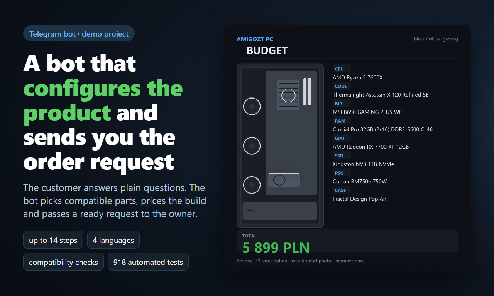
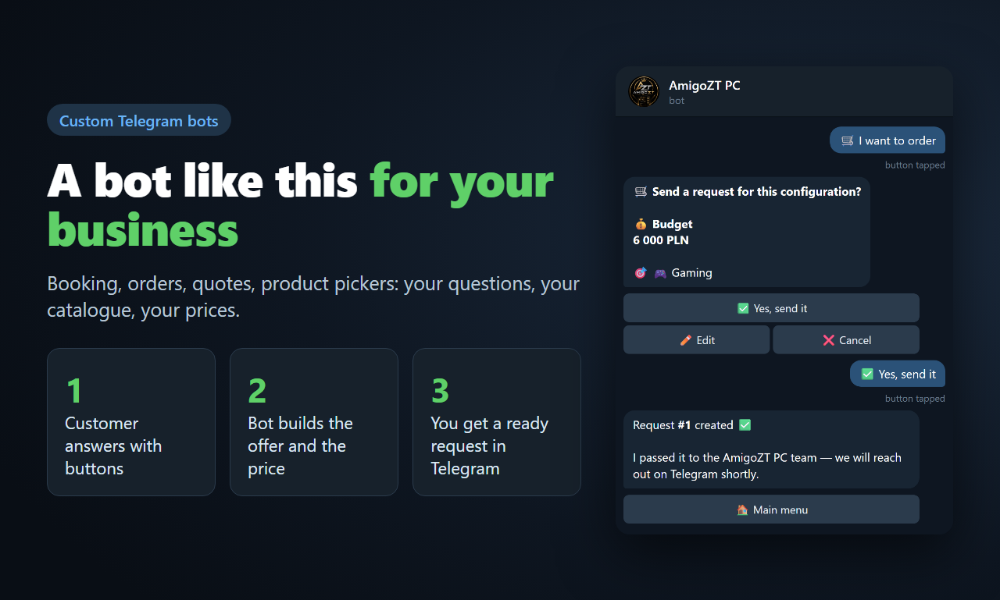
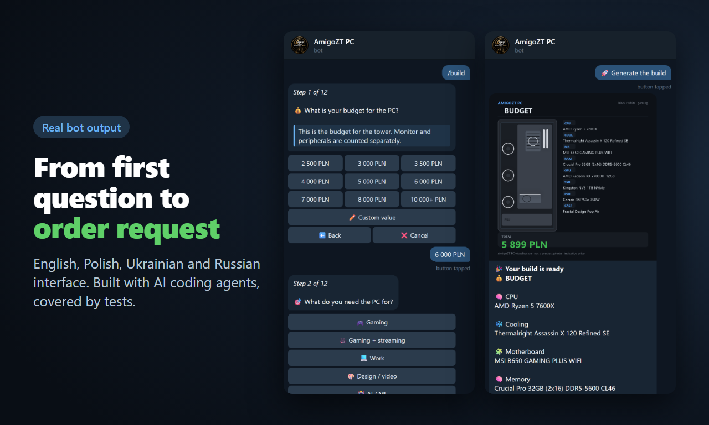

# AmigoZT PC — Telegram PC-build configurator



Telegram bot that configures a custom PC for the Polish market. The user answers plain questions
(budget, games, resolution, looks) and the bot does the technical work: picks compatible parts,
balances price/performance and prices the build in **PLN**.

**Status:** working prototype, run locally (long polling). Component prices in the catalogue are
reference data, not live store prices. No deployment, no real orders yet.

## A bot like this for your business



I build Telegram bots that take orders, bookings or quote requests: your questions, your catalogue, your prices.

| Package | What you get | Delivery | From |
|---|---|---|---|
| Request bot | up to 8 questions with buttons, request to Telegram and Google Sheets, 1 language | 5 days | $120 / 450 PLN |
| Catalogue bot | + catalogue, price calculation, database, admin commands, 2 languages | 10 days | $320 / 1,200 PLN |
| Configurator bot | + rules engine, result card image, saved orders, tests, up to 4 languages | 21 days | $750 / 2,800 PLN |

Built with AI coding agents (Claude Code); every path is tested before you see it. This repository is my own
demo project: no client reviews yet, and I can start with a small paid test.
Contact: [LinkedIn](https://www.linkedin.com/in/roman-zakapko-1997633b0).



## What it does

- **Configurator as data:** the question graph (budget → purpose → games → resolution → FPS → …) lives
  in `app/bot/flows` as data, so the whole conversation is unit-testable without a Telegram server.
- **Compatibility engine** (`app/services/compatibility`): platform, physical, electrical and I/O rules, power
  budget, a gate that blocks incompatible builds, a human-readable report.
- **Pricing** (`app/services/pricing`): PLN pricing, margin and labour, optimiser, validator.
- **AI visualisation** (`app/services/ai`): optional build renders via the OpenAI Images API, cached per
  build, with a spend counter; without a key the bot draws its own schematic card (Pillow).
- **4 languages:** RU / UK / PL / EN (`app/i18n`).
- **Admin & leads:** admin commands restricted to numeric Telegram IDs, purchase requests, anonymised
  funnel analytics (no message text stored).

## Architecture

```
Telegram ──► aiogram 3 dispatcher
               │  middlewares: throttling → DB session → user / language
               ▼
           handlers (thin) ──► flows (question graph as data)
               │
               ▼
           services: catalog · compatibility · recommendation · pricing
                     ready_builds · leads · ai (images) · analytics
               │
               ▼
           domain (pure Pydantic models, no aiogram / SQLAlchemy)
               │
           db: SQLAlchemy 2 async repositories ──► SQLite (dev) / PostgreSQL
                                                    schema via Alembic
```

## Numbers

- ≈20,700 lines of Python in `app/`
- **918 tests** collected by pytest (`pytest --collect-only`, 19.11.2026) — unit and end-to-end
  handler tests
- 43 commits, 22.08–11.09.2026

## Stack

Python 3.13 · aiogram 3 · SQLAlchemy 2 async · Alembic · Pydantic 2 / pydantic-settings · Pillow ·
OpenAI Images · pytest / pytest-asyncio · Ruff · Mypy

## Run it

```bash
python -m venv .venv
.venv/Scripts/python.exe -m pip install -e ".[dev]"
cp .env.example .env          # put your own bot token from @BotFather into .env
.venv/Scripts/alembic.exe upgrade head
.venv/Scripts/python.exe -m app.main
.venv/Scripts/python.exe -m pytest -q
```

## Security

Secrets live only in `.env` (git-ignored) and are wrapped in `SecretStr`; a logging filter redacts
anything token-shaped; per-user throttling runs before any DB work; all user text is HTML-escaped.

## How it was built

Built with AI coding agents (Claude Code). I own the product idea, architecture, business rules and
testing; the agents write code that has to pass the tests and quality gates. The original detailed
project README is in [`docs/PROJECT_README.md`](docs/PROJECT_README.md) (its roadmap section is older
than the code).

## Roadmap

- live store prices instead of reference prices
- deployment (Docker, PostgreSQL) and monitoring
- natural-language assistant on top of the configurator
